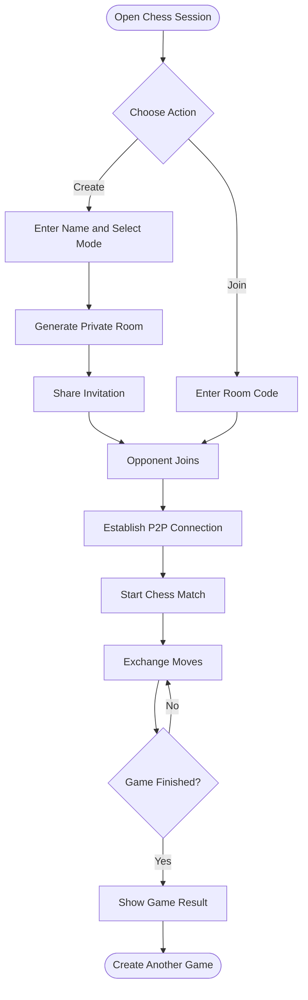

# ♟️ CHESS SESSION — YOUR BOARD. YOUR GAME. YOUR MOVE.

<p align="center">
  
</p>

<p align="center">
  
  
  
  
</p>

<p align="center">
  <b>A private, real-time chess experience built for playing with friends.</b><br/>
  Create a room. Share an invitation. Make your move.
</p>

<p align="center">
  <a href="https://chessy-gfe7.onrender.com/"><b>🌐 PLAY LIVE</b></a> •
  <a href="https://github.com/DSnext412-jpg/chess"><b>📂 SOURCE CODE</b></a>
</p>

---

## ◈ 01 — PROJECT OVERVIEW

**Chess Session** is a browser-based multiplayer chess application that allows two players to play together through a private room.

Instead of requiring accounts, matchmaking systems, or downloads, players can create a temporary room and invite another player using a unique room code or link.

The application uses **PeerJS and WebRTC** for peer-to-peer communication, allowing game moves to synchronize between connected browsers.

### ✦ Core Concept

```text
       PLAYER ONE                         PLAYER TWO
    ┌───────────────┐                 ┌───────────────┐
    │   Create Room │                 │   Join Room   │
    │               │                 │               │
    │   Generate ID │                 │ Enter Room ID │
    └───────┬───────┘                 └───────┬───────┘
            │                                 │
            └───────────┐       ┌─────────────┘
                        ▼       ▼
                  ┌─────────────────┐
                  │   PEER-TO-PEER  │
                  │    CONNECTION   │
                  └────────┬────────┘
                           │
                    ┌──────▼──────┐
                    │ CHESS BOARD │
                    │             │
                    │ Live Moves  │
                    │ Game State  │
                    │ Player Sync │
                    └─────────────┘
```

---

## ◈ 02 — FEATURE MATRIX

| Feature | Description |
|---|---|
| ⚡ Real-time multiplayer | Play with another player through a live connection |
| 🔗 Private room system | Create rooms with unique six-character codes |
| 📩 Invitation links | Share a direct link to join a room |
| ♟️ Standard Chess | Legal chess moves and rule validation |
| ✨ Free Movement | Experimental movement mode |
| 👥 Player identities | Custom display names |
| 🔄 Game synchronization | Synchronize moves between players |
| ↩️ Undo requests | Request permission to take back a move |
| 🔁 Restart game | Request a game restart |
| 🎮 New game | Start another game and swap colors |
| 🤝 Draw offers | Offer and accept a draw |
| 🏳️ Resignation | Resign from an active match |
| 📜 Move history | Review previous moves |
| ♜ Captured pieces | Track captured pieces |
| 🎨 Board themes | Customize the chessboard appearance |
| ♟️ Piece themes | Customize chess piece styles |
| 🔊 Sound effects | Optional game sounds |
| 💡 Legal move hints | Visual move assistance |
| 🔃 Board orientation | Flip the board |
| 📶 Connection status | View connection state and reconnection feedback |
| 🔐 No account required | Start playing without registration |

---

## ◈ 03 — TWO WAYS TO PLAY

### ♟️ Standard Chess

A traditional chess experience with proper move validation.

- Legal piece movement
- Check and checkmate detection
- Castling
- Pawn promotion
- Draw detection
- Standard chess rules

### ✨ Free Movement

A more experimental mode for casual chess sessions.

- Move any piece to any square
- Play without traditional movement restrictions
- Synchronized moves between players
- A different way to experiment with the chessboard

---

## ◈ 04 — HOW IT WORKS



### The workflow

1. **Create:** Player One creates a room and chooses a game mode.
2. **Invite:** A unique room code and invitation link are generated.
3. **Join:** Player Two enters the code or opens the invitation.
4. **Connect:** The browsers establish a peer-to-peer connection.
5. **Play:** Both players interact with the synchronized chessboard.
6. **Finish:** The game ends through its result conditions or player actions.

---

## ◈ 05 — TECHNOLOGY STACK

<p align="center">
  
</p>

| Technology | Purpose |
|---|---|
| React 19 | Component-based UI |
| TypeScript | Type-safe application logic |
| Vite | Development server and build tooling |
| Tailwind CSS | Styling and responsive layouts |
| Framer Motion | Animations and transitions |
| PeerJS | Peer-to-peer connection abstraction |
| WebRTC | Real-time browser communication |
| chess.js | Chess rules and move validation |
| Lucide React | Interface icons |

---

## ◈ 06 — PROJECT ARCHITECTURE

```text
chess/
│
├── public/
│   └── Static assets and icons
│
├── src/
│   │
│   ├── components/
│   │   ├── home/
│   │   ├── ui/
│   │   ├── ChessBoard
│   │   ├── ChessPiece
│   │   ├── GameView
│   │   ├── GameControls
│   │   ├── GameSettings
│   │   ├── MoveHistory
│   │   ├── CapturedPieces
│   │   ├── PlayerInfo
│   │   ├── CreateRoom
│   │   ├── JoinRoom
│   │   └── WaitingRoom
│   │
│   ├── hooks/
│   │   ├── useSession
│   │   ├── usePreferences
│   │   └── useGameSounds
│   │
│   ├── lib/
│   │   ├── gameEngine
│   │   ├── themes
│   │   ├── clipboard
│   │   └── id
│   │
│   ├── session/
│   │   └── SessionManager
│   │
│   ├── types/
│   │   ├── chess
│   │   └── protocol
│   │
│   ├── App.tsx
│   ├── main.tsx
│   └── index.css
│
├── index.html
├── package.json
├── tsconfig.json
├── tailwind.config.js
└── vite.config.ts
```

*The structure above is a simplified overview of the application's main modules.*

---

## ◈ 07 — GETTING STARTED

### Requirements

- Node.js 20.19 or newer
- npm
- A modern web browser
- Internet connection for peer connection services

### 1. Clone the repository

```bash
git clone https://github.com/DSnext412-jpg/chess.git
```

### 2. Enter the project directory

```bash
cd chess
```

### 3. Install dependencies

```bash
npm install
```

### 4. Start the development server

```bash
npm run dev
```

### 5. Open in your browser

```text
http://localhost:5173
```

### Production build

```bash
npm run build
```

### Preview production build

```bash
npm run preview
```

### Type checking

```bash
npm run typecheck
```

---

## ◈ 08 — DESIGN PHILOSOPHY

Chess Session focuses on a premium, distraction-free chess experience.

**Visual direction:**
- Dark luxury interface
- Warm gold accents
- Elegant typography
- Animated transitions
- Interactive chessboard
- Responsive layouts
- Clean player information panels
- Subtle background effects

The goal is simple: make a chess session feel like a focused, premium experience rather than a generic online game.

---

## ◈ 09 — ENGINEERING PRINCIPLES

- **No unnecessary registration:** Keep the entry process simple.
- **Peer-to-peer communication:** Use browser-to-browser data communication for game sessions.
- **Type safety:** Keep application logic maintainable with TypeScript.
- **Component architecture:** Separate game logic, session handling, and interface components.
- **Responsive experience:** Make the interface usable across different screen sizes.
- **Player control:** Keep important game actions synchronized between both participants.

---

## ◈ 10 — FUTURE POSSIBILITIES

Ideas that could extend the project:

- [ ] Spectator mode
- [ ] Chess clocks and timed matches
- [ ] Player statistics and match history
- [ ] AI opponent
- [ ] Replay completed games
- [ ] More board and piece themes
- [ ] Tournament rooms
- [ ] Advanced chess analysis
- [ ] Mobile-first enhancements

*These are possible future improvements, not claims about currently implemented functionality.*

---

## ◈ 11 — CONTRIBUTION

Ideas, suggestions, and improvements are welcome.

1. Fork the repository.
2. Create a feature branch.
3. Make your changes.
4. Test the application.
5. Submit a pull request.

```bash
git checkout -b feature/your-feature
git add .
git commit -m "Add: your feature"
git push origin feature/your-feature
```

---

## ◈ 12 — CONNECT

<p align="center">
  <a href="https://github.com/DSnext412-jpg">
    
  </a>
  <a href="https://dipak-sonawane.onrender.com/">
    
  </a>
</p>

<p align="center">
  <b>Built with ♟️ and a passion for creating interactive experiences.</b>
</p>

<p align="center">
  
</p>
